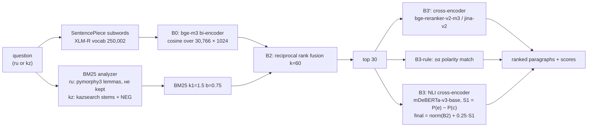

# Technical documentation

Pipeline, dataset card, model card, configuration, and how to train, evaluate, run inference and load
checkpoints. The research write-up is the paper (`docs/paper/paper.pdf`); every number below comes from a
file in `results/`.

## 1. Pipeline



Raw text → cleaning → tokenization → model input → forward pass → scores, step by step:

| Step | Retrieval (bge-m3, BM25) | NLI reranker (trained) |
|---|---|---|
| Raw text | Paragraphs of 22 codes scraped from adilet.zan.kz (`src/scrape/adilet.py`) | XNLI ru/tr pairs, rule-made legal pairs |
| Cleaning / segmentation | Article split into paragraphs; long ones into groups of sub-points; title prepended (`src/retrieval/corpus.py`) | none beyond the dataset's own |
| Tokenization | Dense: XLM-R SentencePiece, truncation 512. BM25: `src/retrieval/morph_ru.py`, `morph_kz.py` | mDeBERTa SentencePiece (250,102), `[CLS] premise [SEP] hypothesis [SEP]`, truncation 128 (train) / 256 (scoring), dynamic padding, attention mask |
| Model input | normalized query and document vectors; BM25 term counts | token ids, attention mask, labels |
| Forward pass | `src/retrieval/dense.py`, `bm25.py`, `fusion.py` | 12-layer encoder → [CLS] pooler (dense + GELU) → linear 768×3 |
| Prediction / loss | cosine, BM25 and RRF scores | softmax over entailment / neutral / contradiction; cross-entropy |
| Training | none (pretrained encoders, frozen) | AdamW, all parameters (`src/rerank/nli_train.py`) |
| Evaluation | `src/eval/run_ablation.py`, `finalize.py`, `stats_extra.py` | `src/rerank/nli_eval.py`, `nli_compare.py` |
| Inference output | ranking of paragraph ids (`app/demo.py`) | P(e), P(n), P(c) per (paragraph, question) |

## 2. Dataset card

### Search corpus
- **Source:** adilet.zan.kz, the official legal database of Kazakhstan; the revision in force in October–November 2026.
- **Scope:** 22 codes whose Russian and Kazakh versions have the same revision date (the Entrepreneurial Code is excluded).
- **Unit:** one chunk per paragraph (`chunk_id = code:article:paragraph[#part]`), 30,766 per language, ids shared across languages.
- **Files:** `data/corpus/{code}_{ru,kz}.jsonl` with `chunk_id, code, article_no, para_no, lang, title, text`.
- **Quality checks:** automatic Ru/Kz alignment for all pairs (`results/alignment_check_*.json`): paragraph numbering agrees in 99.7%, numbers in the text in 99.4%; 18 flagged pairs reviewed by a native speaker, 7 rejected.
- **Licence:** public legislation; see `data/LICENSE.md`.

### Evaluation questions (`data/eval/queries.jsonl`)
- 49 parallel question pairs (98 queries) about the Labor and Tax Codes; the other 20 codes are distractors.
- Fields: `qid, pair_id, lang, slice, question, gold_ids, twin_ids, split, notes`.
- **Labels:** `gold_ids` = paragraph(s) that answer the question; `twin_ids` = paragraph(s) on the same topic with the opposite polarity (negation slice only, empty if the code has none).
- **Slices:** general (25 pairs: answer does not depend on polarity) and negation (24 pairs: confusing permission and prohibition gives the wrong answer).
- **Split:** dev = 5 pairs per slice (tuning of α, NLI scoring and fusion); test = 20 general + 19 negation pairs, 14 of the 19 with a twin. The split is per pair, so a Russian question and its Kazakh version are always in the same split.
- **Annotation:** drafted with an LLM assistant, checked by one native speaker of Kazakh (49 of 50 pairs accepted). No second annotator.

### NLI data (`data/nli/`)
| File | Pairs | Use | Labels (e / n / c) |
|---|---|---|---|
| `xnli_ru.jsonl`, `xnli_tr.jsonl` | 49,998 each | training | XNLI train subsample |
| `synthetic_ru.jsonl`, `synthetic_kz.jsonl` | 3,708 / 2,901 | training (`split=train`), held-out test (`split=test`, by article) | rule-made from the 20 distractor codes only |
| `kardes_kk_test.jsonl` | 2,000 | even half: checkpoint selection; odd half: reported | 326/343/331 and 344/328/328 |
| `val_manual.jsonl` | 50 ru + 50 kz | reported only | 22 / 11 / 17 per language |

Training set of variant a: 105,986 pairs, 34,945 / 34,790 / 36,251: balanced, so accuracy and macro F1 are reported.

**Leakage prevention.** Synthetic pairs never use Labor or Tax Code text, which the questions and the hand-written pairs are built on; the synthetic test split is held out by article; the Kardeş half that selects checkpoints is never reported; the Kardeş dev set is not used because it translates the XNLI validation set the base model was trained on.

**Duplicate check (after the fact).** 46 exact duplicate pairs in the training set (0.04%); 2 of 351 Russian and 3
of 268 Kazakh synthetic test pairs also occur in training (provisions repeated word for word in different
articles); no hand-written premise occurs in training. The two Kardeş halves share no pair but share 564 premises
(XNLI has three hypotheses per premise, and the halves are split by row), so the selection half is not fully
independent of the reported half; selection only chose between two epochs.

## 3. Model card

| | |
|---|---|
| Dense encoder | `BAAI/bge-m3` (24 layers, 1024 hidden), used as is, fp16 |
| Off-the-shelf rerankers | `BAAI/bge-reranker-v2-m3`, `jinaai/jina-reranker-v2-base-multilingual` (CC BY-NC 4.0), max length 512 |
| NLI base | `MoritzLaurer/mDeBERTa-v3-base-xnli-multilingual-nli-2mil7` (12 layers, 768 hidden, 12 heads) |
| Trained checkpoint | `checkpoints/nli-a` (variant a; fp16 weights) |
| Trainable parameters | all; counts in `results/efficiency.json` |
| Head | ContextPooler (dense + GELU) on [CLS] → linear 768 × 3; label order entailment, neutral, contradiction |
| Loss | cross-entropy |
| Rerank score | S1 = P(entailment) − P(contradiction); final score = min-max normalized B2 score + 0.25 · S1 (bge-m3; chosen on dev) |

### Training configuration (`src/rerank/nli_train.py`)
| Setting | Value |
|---|---|
| Optimizer | AdamW (fused on CUDA), weight decay 0.01, gradient clipping 1.0 |
| Learning rate | 1e-5, linear warm-up over 6% of steps, then linear decay |
| Batch | 16 per step × 2 accumulation = 32 |
| Epochs | 2 (6,625 optimizer steps) |
| Max length | 128 tokens |
| Precision | bf16 autocast, fp32 master weights; saved in fp16 |
| Regularization | dropout 0.1 (model default), weight decay |
| Checkpoint rule | best macro F1 on the Kardeş even half after each epoch |
| Seed | 42 (batch order and dropout; the pretrained 3-way head is kept, so nothing is newly initialized) |
| Hardware | NVIDIA RTX 4050 Laptop GPU, 6 GB; PyTorch 2.11, transformers 5.20.2 |
| Variants | a: XNLI ru + tr + synthetic · b: a without tr · c: a without the entailment counter-examples · d: a + SNLI-kk |

Learning curves: `results/nli_curves_a-curves.json`, `results/figures/nli_learning_curves.png` (a repeat of variant a
with logging; the reported model is the original `checkpoints/nli-a`, whose per-epoch log is `results/nli_train_a_mdeberta.json`).

## 4. Reproducing

Setup, data download and all commands are in `README.md`. In short:

```
python -m src.rerank.nli_train --variant a                         # train (about 1–2 h on the laptop GPU)
python -m src.rerank.nli_train --variant a --tag curves --curve-every 200   # same, with learning curves
python -m src.eval.plot_curves --run a-curves
python -m src.eval.finalize --answers data/review/answers          # final tables, diagnostics, NLI evaluation
python -m src.eval.efficiency                                      # sizes, latency, confusion matrices
python -m app.demo                                                 # interactive demo on http://127.0.0.1:7860
```

All seeds are 42. Headline numbers come from the test split after every choice was made on dev; the test split
was not used for selection.

## 5. Loading a checkpoint

```python
from transformers import AutoModelForSequenceClassification, AutoTokenizer
tok = AutoTokenizer.from_pretrained("checkpoints/nli-a")
model = AutoModelForSequenceClassification.from_pretrained("checkpoints/nli-a").eval()
enc = tok(["Работодатель не вправе расторгнуть трудовой договор с беременной женщиной."],
          ["Работодатель может уволить беременную работницу."], return_tensors="pt", truncation=True, max_length=256)
probs = model(**enc).logits.softmax(-1)   # order: entailment, neutral, contradiction
```

Or through the project wrapper: `src.rerank.nli_eval.Classifier("checkpoints/nli-a").probs(premises, hypotheses)`.

Checkpoints (`checkpoints/`), embedding caches and tokenized corpora (`data/index/`) and third-party datasets
(`data/external/`) are not versioned: they are rebuilt by the commands above. Models are downloaded from the
Hugging Face Hub on first use; KazQAD is gated and needs a logged-in account that accepted its terms. No tokens
or credentials are stored in the repository.
